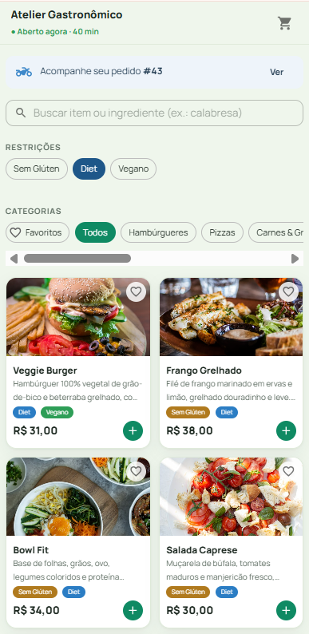
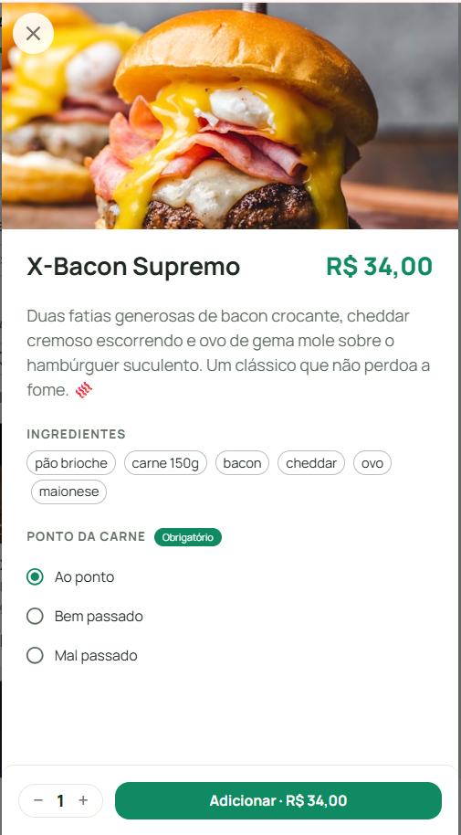
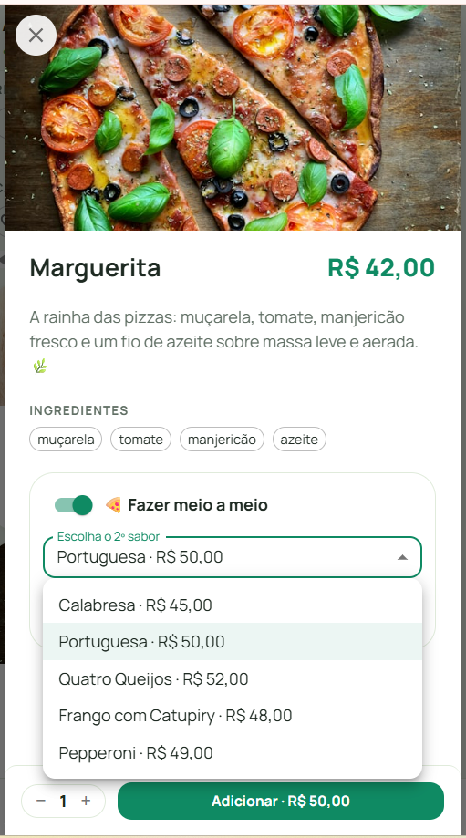
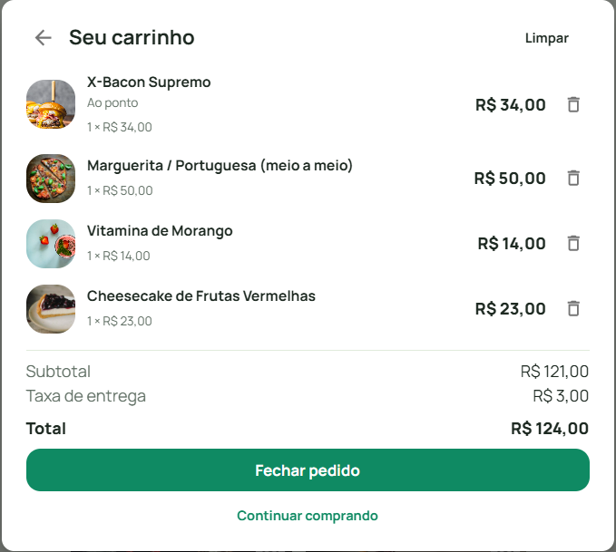
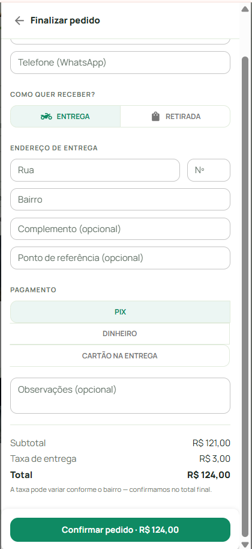
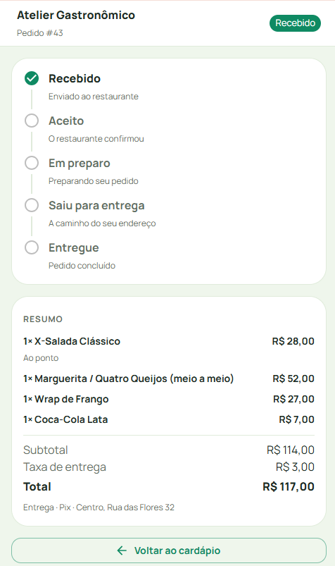
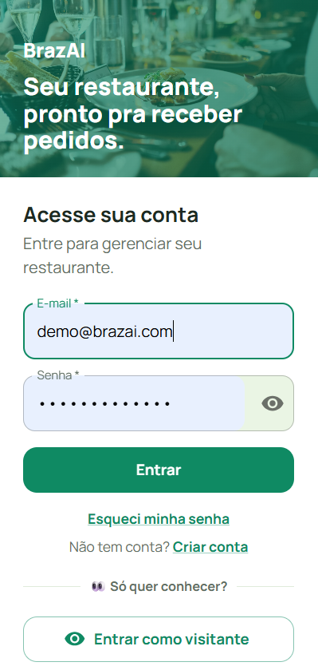
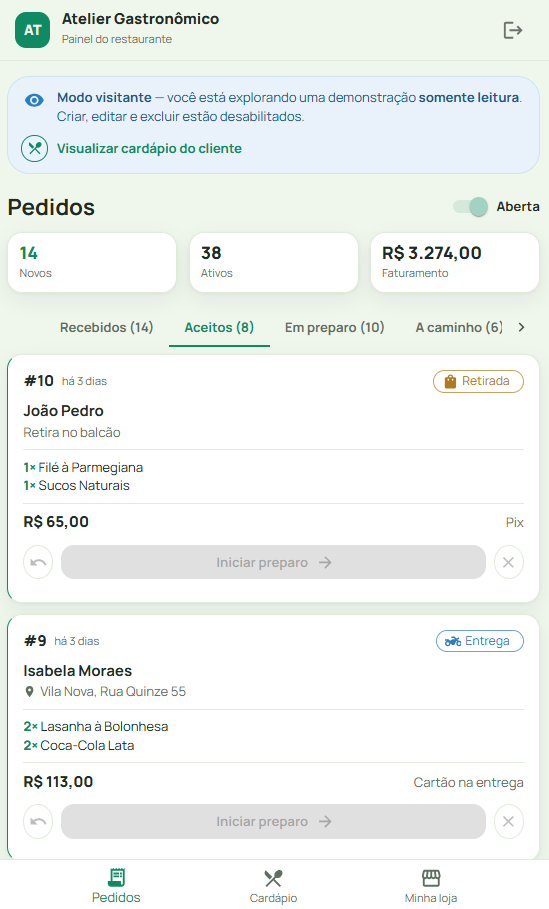

<h1 align="center">🍔 BrazAI</h1>

<p align="center">
  <b>SaaS de delivery multi-tenant para restaurantes</b><br/>
  <i>Multi-tenant delivery SaaS for restaurants — pizzerias, burger joints & more</i><br/>
  <sub>🚧 Atendimento por <b>IA no WhatsApp</b> — em construção · <i>WhatsApp AI agent — work in progress</i></sub>
</p>

<p align="center">
  <a href="https://brazai.vercel.app"><b>▶ Demo ao vivo · Painel (entre como visitante)</b></a>
  &nbsp;·&nbsp;
  <a href="https://brazai.vercel.app/cardapio/atelier-gastronomico"><b>📱 Cardápio do cliente</b></a>
</p>

<p align="center">
  
  
  
  
  
  
  
  
</p>

---

## ✨ Visão geral

O **BrazAI** é um sistema de delivery onde **cada restaurante é um _tenant_ com dados
totalmente isolados** — cardápio, pedidos e configurações próprios. O dono acompanha os
pedidos em tempo real num painel simples, e o cliente pede pelo **cardápio web** (com
checkout e acompanhamento do pedido). Um **agente de IA no WhatsApp** — que monta o pedido
sozinho — está **em construção** 🚧.

*Each restaurant is a fully isolated tenant with its own menu, orders and settings. Owners
track orders in real time; customers order through a web menu (checkout + live tracking).
A WhatsApp AI ordering agent is in progress.*

> 📌 Este é o **repositório-vitrine** do projeto. O código-fonte completo é **privado**
> (produto comercial — as licenças de uso são vendidas). Aqui ficam a **demo ao vivo**,
> **capturas de tela**, a **arquitetura** e **trechos curados** do código.

---

## 🧱 Stack

| Camada | Tecnologias |
|---|---|
| **Backend** | Python · Django · Django REST Framework · JWT (SimpleJWT) |
| **Frontend** | React · TypeScript · Vite · Material UI · React Query · Zustand |
| **IA / WhatsApp** 🚧 | Meta WhatsApp Cloud API · LLM plugável (Groq / Gemini) com _function calling_ — **em construção** |
| **Banco** | PostgreSQL |
| **Qualidade** | 105 testes de backend · checagem de tipos (`tsc`) · Vitest |
| **Deploy** | Vercel (front) · Render (API) · Supabase (DB) |

---

## 🏛️ Arquitetura & destaques

- **Multi-tenancy** (_shared-schema_): coluna `tenant` em todas as tabelas + um
  `TenantFilterMixin` que **isola os dados de cada restaurante automaticamente**, sem
  repetir filtros em cada view.
- **Máquina de estados dos pedidos**: `RECEBIDO → ACEITO → EM_PREPARO → A_CAMINHO →
  CONCLUÍDO` (+ `CANCELADO`), com transições validadas no backend.
- **Pizza meio a meio**: dois sabores num pedido, com preço pelo **sabor mais caro** ou
  pela **média** (configurável por restaurante) — validado e "congelado" no item.
- **Agente de IA no WhatsApp** 🚧 _(em construção)_: recebe mensagens por webhook, monta o
  pedido com _function calling_ e provider de LLM **plugável** (Groq / Gemini / mock).
- **Modo visitante**: middleware de **somente-leitura** deixa visitantes
  explorarem o app por dentro sem alterar os dados.
- **Padrão Selectors/Services**: regra de negócio separada das views → testável sem subir
  um request HTTP.
- **Autenticação JWT** com papéis (`SAAS_ADMIN` / `BUSINESS_ADMIN` / `OPERATOR`); datas em
  **UTC** no banco.

---

## 🔎 Trechos de código · Code highlights

> Amostras **curadas** (não-rodáveis) que mostram o estilo de código e as decisões de
> arquitetura. Arquivos completos em [`snippets/`](snippets/).

### 1. Isolamento multi-tenant — `TenantFilterMixin`

Toda ViewSet que herda este mixin filtra os dados pelo restaurante do usuário logado e
injeta o `tenant` ao criar registros. **Isolamento por construção.**

```python
class TenantFilterMixin:
    def get_queryset(self):
        queryset = super().get_queryset()
        user = self.request.user
        if user.is_authenticated and getattr(user, 'tenant_id', None):
            return queryset.filter(tenant=user.tenant)
        return queryset.none()

    def perform_create(self, serializer):
        tenant = getattr(self.request.user, 'tenant', None)
        if tenant is None:
            raise PermissionDenied('Sua conta não está vinculada a um restaurante.')
        serializer.save(tenant=tenant)
```

### 2. Modo visitante — `ReadOnlyVisitorMiddleware`

A trava por trás do "Entrar como visitante": o visitante VÊ tudo, mas escritas são barradas
no middleware (vale para TODAS as rotas, mesmo as com `permission_classes` próprias).

```python
class ReadOnlyVisitorMiddleware:
    def __call__(self, request):
        if (request.method not in SAFE_METHODS
                and request.path.startswith('/api/')
                and request.path not in _EXEMPT_PATHS):
            result = self._jwt.authenticate(request)
            if result is not None and getattr(result[0], 'is_readonly', False):
                return JsonResponse({'detail': _MESSAGE}, status=403)
        return self.get_response(request)
```

### 3. Regra do meio a meio + teste

Preço pelo sabor mais caro (MAX) ou pela média (AVG), e um teste que prova as duas regras.

```python
def half_and_half_price(settings_obj, price_a, price_b):
    if settings_obj.half_and_half_pricing == settings_obj.AVG:
        return ((price_a + price_b) / Decimal('2')).quantize(CENT, rounding=ROUND_HALF_UP)
    return max(price_a, price_b)

def test_half_and_half_uses_max_price(self):
    order = services.place_order(..., items=[self._pizza_item(second_product=str(self.pizza2.id))])
    self.assertEqual(order.items.first().unit_price, Decimal('50.00'))   # o sabor mais caro
```

---

## 📫 Contato · Contact

- 💼 LinkedIn: [angelica-assini](https://www.linkedin.com/in/angelica-assini/)
- 📧 [assini.angelica@gmail.com](mailto:assini.angelica@gmail.com)

---

## 🖥️ Telas · Screenshots

**Cardápio do cliente** — foto, descrição, restrições e busca por item/ingrediente

<p></p>

**A jornada do cliente · The customer journey**

<table>
  <tr>
    <td width="50%" valign="top" align="center"><b>Escolha do prato + adicionais (ponto da carne)</b><br/></td>
    <td width="50%" valign="top" align="center"><b>Pizza meio a meio</b><br/></td>
  </tr>
  <tr>
    <td valign="top" align="center"><b>Carrinho</b><br/></td>
    <td valign="top" align="center"><b>Checkout</b><br/></td>
  </tr>
</table>

**Acompanhamento do pedido em tempo real · Live order tracking**

<p></p>

**Acesso & painel do restaurante · Login & owner panel** — entre em 1 clique com **"Entrar como visitante"**

<table>
  <tr>
    <td width="50%" valign="top" align="center"><b>Login (modo visitante)</b><br/></td>
    <td width="50%" valign="top" align="center"><b>Esteira de pedidos (tempo real)</b><br/></td>
  </tr>
</table>
